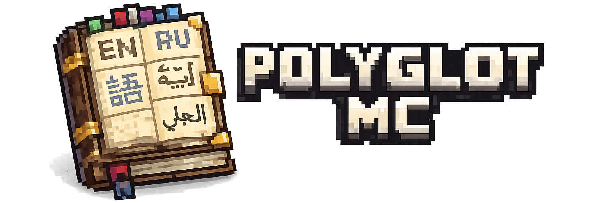

<p align="center">
  
</p>

<h1 align="center">POLYGLOT MC</h1>

<p align="center">
  <b>Version-aware Java library for translating Minecraft item names into multiple languages.</b>
</p>

<p align="center">
  <i>Because Minecraft items deserved to speak every language.</i>
</p>

---

## Overview

**PolyglotMC** is a lightweight Java library for Paper plugins that turns Minecraft names — items, blocks, entities, enchantments, effects, biomes, advancements and anything else in the game's language files — into **plain strings in any game language**, for a chosen **Minecraft version**, right on the server.

The library fetches official Minecraft language assets, caches them efficiently, and exposes a clean API for translating names into human-readable localized strings.

---

## Features

- Supports **100+ Minecraft languages**
- Works across **many Minecraft versions** (1.13+)
- Translates any Paper object with a translation key, or any raw key
- Automatic translation loading and caching

---

## Adding it to your project

Published to Maven Central. Requires Java 17+ and Paper API on the classpath.

**Gradle (Kotlin DSL)**

```kotlin
repositories {
    mavenCentral()
}

dependencies {
    implementation("sk.dverka:polyglotmc:2.1.0")
}
```

**Gradle (Groovy DSL)**

```groovy
repositories {
    mavenCentral()
}

dependencies {
    implementation 'sk.dverka:polyglotmc:2.1.0'
}
```

**Maven**

```xml
<dependency>
    <groupId>sk.dverka</groupId>
    <artifactId>polyglotmc</artifactId>
    <version>2.1.0</version>
</dependency>
```

At runtime the library has to reach your plugin: either shade it into the plugin jar
(e.g. with the Shadow plugin), or let the server download it from Maven Central via `plugin.yml`:

```yaml
libraries:
  - sk.dverka:polyglotmc:2.1.0
```

The classes live in the `ru.dverkask.polyglotmc` package whatever the coordinates are,
so imports look like `import ru.dverkask.polyglotmc.api.Polyglot`.

Earlier versions (up to `2.0.0`) are only on [JitPack](https://jitpack.io/#DverkaSK/PolyglotMC),
as `com.github.DverkaSK:PolyglotMC:<tag>` from `maven("https://jitpack.io")`.

---

## Basic Usage

### Creating a Polyglot instance

```java
Polyglot polyglot = new Polyglot.Builder()
        .withVersion(SupportedVersion.Release.V1_20_4)
        .withLanguages(
                SupportedLanguage.EN_US,
                SupportedLanguage.RU_RU,
                SupportedLanguage.JA_JP
        )
        .withDefaultLanguage(SupportedLanguage.EN_US)
        .build();
```

### Translating game objects

Anything that implements Adventure's `Translatable` can be translated:
`Material`, `ItemStack`, `EntityType`, `Enchantment`, `PotionEffectType`, `Biome`, `Attribute`, `GameRule` and more.

```java
polyglot.translate(Material.DIAMOND_SWORD, SupportedLanguage.RU_RU).translatedName();  // Алмазный меч
polyglot.translate(Enchantment.SHARPNESS, SupportedLanguage.RU_RU).translatedName();    // Острота
polyglot.translate(EntityType.CREEPER, SupportedLanguage.RU_RU).translatedName();       // Крипер
polyglot.translate(PotionEffectType.SPEED, SupportedLanguage.RU_RU).translatedName();   // Скорость
```

### Translating raw keys

```java
polyglot.translate("gamerule.keepInventory", SupportedLanguage.RU_RU).translatedName(); // Сохранение инвентаря при смерти
```

If a key is missing in the requested language, the default language translation is returned
(or the key itself), and `TranslationResult#isTranslated()` is `false`.

### Versions

Any version from `SupportedVersion` can be used, as well as versions that are not listed yet:

```java
new Polyglot.Builder().withVersion(Version.of("26.1.2"));
```

If no version is set, the version of the running server is used.

Only Minecraft **1.13 and newer** are supported (older versions use a different language file format):
`withVersion` throws `IllegalArgumentException` for them, and their `SupportedVersion` constants are deprecated.

> Language files are downloaded from GitHub when `build()` is called, so consider building `Polyglot` asynchronously.
> If a file cannot be loaded, `build()` throws `UncheckedIOException`.

### Caching language files on disk

Without a cache directory the files are downloaded on every start. With one, they are downloaded once:

```java
Polyglot polyglot = new Polyglot.Builder()
        .withLanguages(SupportedLanguage.EN_US, SupportedLanguage.RU_RU)
        .withCacheDirectory(plugin.getDataFolder().toPath().resolve("lang"))
        .build();
```

### Dynamic Language Loading

```java
Polyglot polyglot = new Polyglot.Builder()
        .withVersion(SupportedVersion.Release.V1_21)
        .withLanguages(SupportedLanguage.EN_US)
        .withDynamicLanguageLoading(true)
        .build();
```

A language that was not specified is loaded in the background on first use, so `translate` never blocks.
Until it is loaded, the default language translation is returned and `isTranslated()` is `false`.
A failed load is retried, at most once a minute.

---